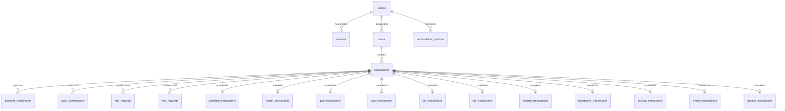

# Cafe Lupe Centralized Sales Report & Transaction Gateway — Database Schema

**Version:** Revision 002  
**Storage Engine (Client Prototype):** Reactive relational store persisted under `localStorage` prefix `cafelupe_v3_rev002_` (`src/db/store.ts` & `src/types/index.ts`)  
**Target RDBMS (Production Blueprint):** MySQL 8+ / MariaDB (`InnoDB`, `utf8mb4_unicode_ci`) generated via `store.generateMySQLSchema()`

---

## 1. Relational Overview & Entity-Relationship Diagram

The database follows a **centralized master-ledger + normalized child-table architecture**:

1. **`transactions`** serves as the single unified ledger across all outlets (`R1`, `NFR7`, `NFR9`), storing shared financial totals, payment states, timer metadata, and concurrency lock fields.
2. **`payment_installments`** (`1:N` with `transactions`) isolates `'initial'` payments/down payments from `'balance'` follow-up settlements so each step can independently track `Cash` vs. `QRPh`, amount, receiver, and timestamp.
3. **11 Dedicated Outlet Child Tables** (`1:1` with `transactions` via `outletRefTable` + `outletRefId`, plus `transactionId` FK) preserve outlet-specific operational attributes (`NFR8`).
4. **Governance Queues** (`cash_confirmations`, `edit_requests`, `void_requests`) manage Accountant approvals, Front-Desk submissions, and cash deposit audits.
5. **AI Audit & Bank Reconciliation Tables** (`ai_audit_logs`, `reconciliation_batches`) persist Gemini OCR deposit-slip extractions, forecasts, and per-outlet bank statement comparisons.



---

## 2. Core Directory & Authentication Tables

### 2.1 `users`
Stores credentials, role routing, outlet assignment, and registration approval status.

| Column | Type | Key / Constraints | Description |
| :--- | :--- | :--- | :--- |
| `id` | `VARCHAR(50)` | **PK**, `NOT NULL` | Unique user identifier (`usr-*`) |
| `name` | `VARCHAR(100)` | `NOT NULL` | Display name of staff/admin/accountant |
| `email` | `VARCHAR(150)` | `UNIQUE`, `NOT NULL` | Login email used for role-based portal routing |
| `password` | `VARCHAR(255)` | `NULL` (optional in TS, `NOT NULL` in SQL) | Account credential |
| `role` | `ENUM('staff', 'admin', 'accountant')` | `NOT NULL`, default `'staff'` | `'admin'` = Front-Desk (operates 9 merged outlets); `'accountant'` = Accounting & AI; `'staff'` = Gym or F&B POS |
| `outletId` / `outlet_id` | `VARCHAR(50)` | **FK -> `outlets.id`**, `NULL` | `NULL` for Front-Desk (`admin`) and `accountant`; `'out-gym'` or `'out-fnb'` for standalone portals |
| `outletName` | `VARCHAR(100)` | `NULL` | Human-readable assignment label (e.g., `'Front-Desk (All Outlets)'`) |
| `approvalStatus` / `approval_status` | `ENUM('pending', 'approved', 'rejected')` | `NOT NULL`, default `'pending'` | Controlled by Front-Desk (`AdminDashboard`) |
| `createdAt` / `created_at` | `DATETIME` | `NOT NULL` | ISO-8601 / SQL creation timestamp |

---

### 2.2 `outlets`
Master registry of Cafe Lupe operational outlets (10 built-in + dynamically added outlets).

| Column | Type | Key / Constraints | Description |
| :--- | :--- | :--- | :--- |
| `id` | `VARCHAR(50)` | **PK**, `NOT NULL` | Outlet ID (e.g., `'out-pickleball'`, `'out-fnb'`) |
| `slug` | `VARCHAR(50)` | `UNIQUE`, `NOT NULL` | One of `pickleball`, `hostel`, `gym`, `pool`, `ktv`, `fnb`, `billiards`, `tabletennis`, `parking`, `events`, `custom`, or generated slug |
| `name` | `VARCHAR(100)` | `NOT NULL` | Outlet display name |
| `description` | `TEXT` | `NOT NULL` | Operational summary |
| `template` | `VARCHAR(50)` | `NULL` | Optional template key for dynamic outlets (`'generic'`, `'pickleball'`, `'fnb'`) |
| `isActive` / `is_active` | `BOOLEAN` / `TINYINT(1)` | `NOT NULL`, default `1` | Active flag |
| `category` | `ENUM('sports', 'hospitality', 'entertainment', 'dining', 'general')` | `NOT NULL` | Functional grouping |

---

### 2.3 `services`
Service preset items per outlet (primarily used for Events & dynamically added outlets).

| Column | Type | Key / Constraints | Description |
| :--- | :--- | :--- | :--- |
| `id` | `VARCHAR(50)` | **PK**, `NOT NULL` | Service preset ID (`srv-*`) |
| `outletId` / `outlet_id` | `VARCHAR(50)` | **FK -> `outlets.id`**, `NOT NULL` | Owning outlet |
| `name` | `VARCHAR(150)` | `NOT NULL` | Service/package name |
| `defaultPrice` | `DECIMAL(10, 2)` | `NOT NULL` | Default base price in PHP |
| `category` | `VARCHAR(80)` | `NULL` | Optional preset grouping |
| `presetFields` | `JSON` | `NOT NULL` | Key-value defaults applied when selected |
| `isActive` | `BOOLEAN` | `NOT NULL`, default `1` | Active flag |

---

## 3. Master Ledger & Split Payment Tables

### 3.1 `transactions`
Unified financial ledger recording every transaction across all outlets (`NFR1`, `NFR7`, `NFR9`).

| Column | Type | Key / Constraints | Description |
| :--- | :--- | :--- | :--- |
| `transactionID` | `VARCHAR(50)` | **PK**, `NOT NULL` | Format `TRX-YYYY-NNNN` |
| `outletName` | `VARCHAR(100)` | `NOT NULL` | Name of originating outlet |
| `outletSlug` | `VARCHAR(50)` | `NOT NULL` | Slug of originating outlet |
| `outletService` | `VARCHAR(200)` | `NOT NULL` | Rendered summary of service/order |
| `customerName` | `VARCHAR(150)` | `NOT NULL` | Customer name (or plate/guest label) |
| `employeeHandler` | `VARCHAR(100)` | `NOT NULL` | Staff member who created the record |
| `employeeId` | `VARCHAR(50)` | **FK -> `users.id`**, `NOT NULL` | ID of creating staff user |
| `cashReceivedBy` | `VARCHAR(100)` | `NULL` | Staff member who physically collected Cash |
| `transactionAmount` | `DECIMAL(10, 2)` | `NOT NULL` | Gross selling price before discount |
| `discountApplied` | `TINYINT(1)` | `NOT NULL`, default `0` | `1` (`Yes`) or `0` (`No`) |
| `discount` | `DECIMAL(10, 2)` | `NOT NULL`, default `0.00` | Computed SC/PWD discount deduction |
| `totalAmount` | `DECIMAL(10, 2)` | `NOT NULL` | Final net payable (`transactionAmount - discount`) |
| `amountPaid` | `DECIMAL(10, 2)` | `NOT NULL`, default `0.00` | Cumulative amount collected so far |
| `balanceDue` | `DECIMAL(10, 2)` | `NOT NULL`, default `0.00` | Remaining amount due (`totalAmount - amountPaid`, `0` when void) |
| `transactionStatus` | `ENUM('pending', 'paid', 'void')` | **INDEX**, `NOT NULL`, default `'pending'` | Lifecycle status |
| `transactionDateTime` | `DATETIME` | **INDEX**, `NOT NULL` | Timestamp when created |
| `paymentArrangement` | `ENUM('Full Payment', 'Down Payment')` | `NOT NULL` | Upfront or split arrangement (F&B POS uses `'Full Payment'` only) |
| `paymentChannel` | `ENUM('Cash', 'QRPh')` | `NOT NULL` | Latest/active payment channel |
| `initialPaymentMode` / `initial_payment_mode` | `ENUM('Cash', 'QRPh')` | `NULL` | Channel used for the `'initial'` phase |
| `balancePaymentMode` / `balance_payment_mode` | `ENUM('Cash', 'QRPh')` | `NULL` | Channel used for the `'balance'` phase (supports independent mode switch) |
| `outletRefTable` / `outlet_ref_table` | `VARCHAR(50)` | `NOT NULL` | Target child table name (e.g., `'pickleball_transactions'`) |
| `outletRefId` / `outlet_ref_id` | `VARCHAR(50)` | `NOT NULL` | Primary key of linked child row |
| `qrToken` / `qr_token` | `VARCHAR(100)` | `NULL` | Generated QR Ph prototype token (`QRPH-YYYY-OUTLET-XXXXXX`) |
| `paidAt` / `paid_at` | `DATETIME` | `NULL` | Timestamp when `balanceDue` reached `0` |
| `hourlyRate` | `DECIMAL(10, 2)` | `NULL` | Remembered hourly rate used by **Extend** on timed outlets |
| `timerDurationMinutes` | `INT` | `NULL` | Configured session duration in minutes (`billiards`, `pickleball`, `tabletennis`, `ktv`) |
| `timerStartedAt` | `DATETIME` | `NULL` | Countdown start timestamp |
| `timerEndsAt` | `DATETIME` | `NULL` | Countdown target end timestamp |
| `timerStoppedAt` / `timer_stopped_at` | `DATETIME` | `NULL` | Timestamp if staff stopped the session early via **Stop** |
| `timerAcknowledged` | `TINYINT(1)` | `NOT NULL`, default `0` | `1` once staff acknowledges expired timer overlay or stops timer |
| `lockedBy` / `locked_by` | `VARCHAR(50)` | `NULL` | User ID holding the 120-second pessimistic edit lock (`NFR6`) |
| `lockedByName` | `VARCHAR(100)` | `NULL` | Name of user holding edit lock |
| `lockedAt` / `locked_at` | `DATETIME` | `NULL` | Lock acquisition timestamp |
| `version` | `INT UNSIGNED` | `NOT NULL`, default `1` | Optimistic concurrency version counter incremented on updates |

---

### 3.2 `payment_installments` (Revision 002)
Normalized split-payment ledger tracking initial payments/down payments separately from balance settlements.

| Column | Type | Key / Constraints | Description |
| :--- | :--- | :--- | :--- |
| `installmentID` | `VARCHAR(50)` | **PK**, `NOT NULL` | Unique installment ID (`inst-*`) |
| `transactionId` / `transaction_id` | `VARCHAR(50)` | **FK -> `transactions.transactionID`** (`ON DELETE CASCADE`), `NOT NULL` | Parent master transaction |
| `phase` | `ENUM('initial', 'balance')` | `NOT NULL` | `'initial'` = upfront or down payment; `'balance'` = follow-up settlement |
| `paymentChannel` / `payment_channel` | `ENUM('Cash', 'QRPh')` | `NOT NULL` | Channel used specifically for this installment |
| `amount` | `DECIMAL(10, 2)` | `NOT NULL` | Exact installment amount |
| `status` | `ENUM('pending', 'confirmed', 'voided')` | `NOT NULL`, default `'pending'` | `'voided'` if initial down payment is cancelled |
| `cashReceivedBy` / `cash_received_by` | `VARCHAR(100)` | `NULL` | Receiver recorded for Cash installments |
| `qrToken` / `qr_token` | `VARCHAR(100)` | `NULL` | QR Ph token for QRPh installments |
| `paidAt` / `paid_at` | `DATETIME` | `NULL` | Timestamp installment was settled |
| `createdAt` / `created_at` | `DATETIME` | `NOT NULL` | Creation timestamp |

---

## 4. Outlet-Specific Child Tables (`*_transactions`)

Every row in `transactions` points `1:1` via `(outletRefTable, outletRefId)` to one of the following tables:

### 4.1 `pickleball_transactions`
| Column | Type | Key / Constraints | Description |
| :--- | :--- | :--- | :--- |
| `pickleballID` | `VARCHAR(50)` | **PK**, `NOT NULL` | Child record ID |
| `transactionId` / `transaction_id` | `VARCHAR(50)` | **FK -> `transactions.transactionID`**, `NOT NULL` | Master transaction reference |
| `court` | `ENUM('Al Fresco (Ground Floor)', 'Indoor (2nd Floor)')` | `NOT NULL` | Court location |
| `pax` | `INT` | `NOT NULL`, default `2` | Number of players (`₱150/pax/hr`) |
| `hours` | `INT` | `NOT NULL`, default `1` | Booked hours (extended via **Extend**) |
| `paddleRent` / `paddle_rent` | `INT` | `NOT NULL`, default `0` | Paddle count (`₱100` each) |
| `ballRent` / `ball_rent` | `INT` | `NOT NULL`, default `0` | Ball count (`₱50` each) |

### 4.2 `hostel_transactions`
| Column | Type | Key / Constraints | Description |
| :--- | :--- | :--- | :--- |
| `hostelID` | `VARCHAR(50)` | **PK**, `NOT NULL` | Child record ID |
| `transactionId` / `transaction_id` | `VARCHAR(50)` | **FK -> `transactions.transactionID`**, `NOT NULL` | Master transaction reference |
| `roomType` / `room_type` | `ENUM('2 Single Bed', 'King Size Bed', 'Queen Size Bed', 'Suite Room - Overlooking')` | `NOT NULL` | Room tier (`₱1,680` / `₱3,136` / `₱2,800` / `₱4,480`) |
| `roomRatePerNight` / `room_rate_per_night` | `DECIMAL(10, 2)` | `NOT NULL` | Nightly rate (12% VAT-inclusive, no service charge) |
| `bookingSource` / `booking_source` | `ENUM('Walk-in', 'Agoda', 'Traveloka')` | `NOT NULL`, default `'Walk-in'` | Reservation channel |
| `checkIn` / `check_in` | `DATE` | `NOT NULL` | Check-in date |
| `checkOut` / `check_out` | `DATE` | `NOT NULL` | Check-out date |
| `numberOfNights` / `number_of_nights` | `INT` | `NOT NULL`, default `1` | Auto-computed stay duration |
| `amenities` | `VARCHAR(100)` | `NULL` | Complimentary amenity label (no extra charge) |
| `vatIncluded` / `vat_included` | `TINYINT(1)` | `NOT NULL`, default `1` | `1` (12% VAT included) |

### 4.3 `gym_transactions`
| Column | Type | Key / Constraints | Description |
| :--- | :--- | :--- | :--- |
| `gymID` | `VARCHAR(50)` | **PK**, `NOT NULL` | Child record ID |
| `transactionId` / `transaction_id` | `VARCHAR(50)` | **FK -> `transactions.transactionID`**, `NOT NULL` | Master transaction reference |
| `age` | `INT` | `NOT NULL` | Client age |
| `membershipStart` / `membership_start` | `DATE` | `NOT NULL` | Start date of membership/session |
| `serviceCategory` / `service_category` | `ENUM('Annual Membership', 'Monthly Package', 'Per-Session Training', 'Self-Train Session')` | `NOT NULL` | Cascaded top-level category |
| `membershipType` / `membership_type` | `VARCHAR(60)` | `NOT NULL` | Membership descriptor |
| `plan` | `VARCHAR(100)` | `NOT NULL` | Selected package/session name |
| `clientStatus` / `client_status` | `ENUM('Member', 'Non-Member', 'Student (Member)', 'Student (Non-Member)')` | `NOT NULL` | Rate tier |
| `trainerProgram` / `trainer_program` | `VARCHAR(100)` | `NULL` | e.g., `'Boxing'`, `'Muay Thai'`, `'Unlimited'` |
| `inclusions` | `JSON` | `NULL` | Array of included perks/equipment |

### 4.4 `pool_transactions`
| Column | Type | Key / Constraints | Description |
| :--- | :--- | :--- | :--- |
| `poolID` | `VARCHAR(50)` | **PK**, `NOT NULL` | Child record ID |
| `transactionId` / `transaction_id` | `VARCHAR(50)` | **FK -> `transactions.transactionID`**, `NOT NULL` | Master transaction reference |
| `guestType` / `guest_type` | `ENUM('Walk-in', 'Hotel Guest')` | `NOT NULL` | Guest classification |
| `adults` | `INT` | `NOT NULL`, default `0` | Adult count (`₱300` walk-in) |
| `children` | `INT` | `NOT NULL`, default `0` | Child count (`₱150` walk-in) |
| `isHostelGuest` / `is_hostel_guest` | `TINYINT(1)` | `NOT NULL`, default `0` | `1` = complimentary (`₱0.00`) |
| `visitDay` | `VARCHAR(30)` | `NOT NULL` | Visit day indicator (e.g., `'Weekday'`) |

### 4.5 `ktv_transactions`
| Column | Type | Key / Constraints | Description |
| :--- | :--- | :--- | :--- |
| `ktvID` | `VARCHAR(50)` | **PK**, `NOT NULL` | Child record ID |
| `transactionId` / `transaction_id` | `VARCHAR(50)` | **FK -> `transactions.transactionID`**, `NOT NULL` | Master transaction reference |
| `room` | `ENUM('Room 1', 'Room 2', 'Room 3', 'Room 4')` | `NOT NULL` | Assigned KTV room |
| `packageType` / `package_type` | `ENUM('Custom Hourly', 'KTV 1 & 2 Package', 'KTV Suite 4 Package')` | `NOT NULL` | Hourly vs. consumable package |
| `packageConsumable` / `package_consumable` | `DECIMAL(10, 2)` | `NOT NULL`, default `0.00` | Consumable F&B credit (`₱0`, `₱5,000`, or `₱15,000`) |
| `pax` | `INT` | `NOT NULL` | Guest headcount |
| `hours` | `INT` | `NOT NULL`, default `1` | Booked hours (`₱1,000/hr`) |
| `hourlyRate` / `hourly_rate` | `DECIMAL(10, 2)` | `NOT NULL`, default `1000.00` | Hourly room rate |
| `package` | `VARCHAR(150)` | `NOT NULL` | Full package label |

### 4.6 `fnb_transactions` (Updated in Revision 002)
| Column | Type | Key / Constraints | Description |
| :--- | :--- | :--- | :--- |
| `fnbID` | `VARCHAR(50)` | **PK**, `NOT NULL` | Child record ID |
| `transactionId` / `transaction_id` | `VARCHAR(50)` | **FK -> `transactions.transactionID`**, `NOT NULL` | Master transaction reference |
| `auditedTo` / `audited_to` | `ENUM('Walk-in Client', 'Function Guest', 'KTV Room User')` | `NOT NULL` | Dining audit target |
| `tableOrRoomNo` / `table_or_room_no` | `VARCHAR(50)` | `NULL` | Table or room number |
| `orderItems` / `order_items` | `JSON` | `NOT NULL` | Array of `{ itemId, name, variant?, price, quantity, subtotal }` |
| `totalPax` / `total_pax` | `INT` | `NOT NULL`, default `1` | **New (Rev 002):** Total diners on bill (for SC/PWD split formula) |
| `validIdCount` / `valid_id_count` | `INT` | `NOT NULL`, default `0` | **New (Rev 002):** Number of valid SC/PWD IDs (`0 <= validIdCount <= totalPax`) |
| `receiptPrintedAt` / `receipt_printed_at` | `DATETIME` | `NULL` | Kitchen ticket print timestamp |

### 4.7 `billiards_transactions`
| Column | Type | Key / Constraints | Description |
| :--- | :--- | :--- | :--- |
| `billiardsID` | `VARCHAR(50)` | **PK**, `NOT NULL` | Child record ID |
| `transactionId` / `transaction_id` | `VARCHAR(50)` | **FK -> `transactions.transactionID`**, `NOT NULL` | Master transaction reference |
| `place` | `ENUM('Without Aircon (₱200/hr)', 'With Aircon (₱400/hr)')` | `NOT NULL` | Area selection |
| `hourlyRate` / `hourly_rate` | `DECIMAL(10, 2)` | `NOT NULL` | `200.00` or `400.00` |
| `hours` | `INT` | `NOT NULL`, default `1` | Booked hours |

### 4.8 `tabletennis_transactions`
| Column | Type | Key / Constraints | Description |
| :--- | :--- | :--- | :--- |
| `tabletennisID` | `VARCHAR(50)` | **PK**, `NOT NULL` | Child record ID |
| `transactionId` / `transaction_id` | `VARCHAR(50)` | **FK -> `transactions.transactionID`**, `NOT NULL` | Master transaction reference |
| `tableNo` / `table_no` | `ENUM('Table 1', 'Table 2', 'Table 3')` | `NOT NULL` | Ping-pong table number |
| `hourlyRate` / `hourly_rate` | `DECIMAL(10, 2)` | `NOT NULL`, default `250.00` | Fixed hourly rate |
| `hours` | `INT` | `NOT NULL`, default `1` | Booked hours |

### 4.9 `parking_transactions`
| Column | Type | Key / Constraints | Description |
| :--- | :--- | :--- | :--- |
| `parkingID` | `VARCHAR(50)` | **PK**, `NOT NULL` | Child record ID |
| `transactionId` / `transaction_id` | `VARCHAR(50)` | **FK -> `transactions.transactionID`**, `NOT NULL` | Master transaction reference |
| `plateNumber` / `plate_number` | `VARCHAR(20)` | `NOT NULL` | Uppercased plate number |
| `vehicleType` / `vehicle_type` | `ENUM('Car', 'Van', 'Truck', 'Tricycle', 'Motorcycle', 'Others')` | `NOT NULL` | Vehicle class |
| `customVehicleName` / `custom_vehicle_name` | `VARCHAR(100)` | `NULL` | Manual vehicle name when `vehicleType = 'Others'` |
| `wheelCount` / `wheel_count` | `TINYINT` | `NOT NULL`, default `4` | `2` (`₱30`) or `4` (`₱50`) |
| `parkingType` / `parking_type` | `ENUM('Day', 'Night', 'Overnight')` | `NOT NULL` | Parking shift |
| `isCheckedInGuest` / `is_checked_in_guest` | `TINYINT(1)` | `NOT NULL`, default `0` | `1` = free guest parking (`₱0.00`) |

### 4.10 `events_transactions`
| Column | Type | Key / Constraints | Description |
| :--- | :--- | :--- | :--- |
| `eventsID` | `VARCHAR(50)` | **PK**, `NOT NULL` | Child record ID |
| `transactionId` / `transaction_id` | `VARCHAR(50)` | **FK -> `transactions.transactionID`**, `NOT NULL` | Master transaction reference |
| `eventType` / `event_type` | `ENUM('Pre-Christmas Party', 'Corporate Event', 'Concert', 'TV Show Location', 'Indie Film Shoot', 'Commercial Shoot', 'Private Birthday/Celebration')` | `NOT NULL` | Function or shoot category |
| `eventDate` / `event_date` | `DATE` | `NOT NULL` | Scheduled event date |
| `headcount` | `INT` | `NOT NULL` | Expected guests/crew size |
| `spaceReserved` / `space_reserved` | `VARCHAR(120)` | `NOT NULL` | Reserved venue area |

### 4.11 `generic_transactions`
Fallback child table for dynamically created outlets added via Front-Desk **Add outlet** (`FR88`).

| Column | Type | Key / Constraints | Description |
| :--- | :--- | :--- | :--- |
| `genericID` | `VARCHAR(50)` | **PK**, `NOT NULL` | Child record ID |
| `transactionId` / `transaction_id` | `VARCHAR(50)` | **FK -> `transactions.transactionID`**, `NOT NULL` | Master transaction reference |
| `notes` | `TEXT` | `NOT NULL` | Staff notes |
| `customDetails` | `JSON` | `NOT NULL` | Dynamic key-value attributes |

---

## 5. Governance & Approval Tables (Accountant-Owned in Revision 002)

### 5.1 `cash_confirmations`
Tracks physical Cash payments awaiting Accountant bank-deposit confirmation.

| Column | Type | Key / Constraints | Description |
| :--- | :--- | :--- | :--- |
| `id` | `VARCHAR(50)` | **PK**, `NOT NULL` | Queue record ID (`csh-*`) |
| `transactionId` | `VARCHAR(50)` | **FK -> `transactions.transactionID`**, `NOT NULL` | Parent transaction |
| `installmentId` | `VARCHAR(50)` | **FK -> `payment_installments.installmentID`**, `NULL` | Linked Cash installment (supports two-step down payments) |
| `outletName` | `VARCHAR(100)` | `NOT NULL` | Originating outlet |
| `customerName` | `VARCHAR(150)` | `NOT NULL` | Customer name |
| `amount` | `DECIMAL(10, 2)` | `NOT NULL` | Cash installment amount collected |
| `cashReceivedBy` | `VARCHAR(100)` | `NULL` | Staff member holding cash |
| `status` | `ENUM('pending_audit', 'confirmed')` | `NOT NULL` | Audit status |
| `approvedBy` | `VARCHAR(100)` | `NULL` | Accountant who confirmed cash deposit |
| `approvedAt` | `DATETIME` | `NULL` | Confirmation timestamp |
| `createdAt` | `DATETIME` | `NOT NULL` | Creation timestamp |

### 5.2 `edit_requests`
Stores transaction edit proposals submitted by Front-Desk (`admin`) or staff requiring Accountant approval. *(Accountant direct edits bypass this table via `accountantDirectUpdate`.)*

| Column | Type | Key / Constraints | Description |
| :--- | :--- | :--- | :--- |
| `id` | `VARCHAR(50)` | **PK**, `NOT NULL` | Request ID (`edit-*`) |
| `transactionId` | `VARCHAR(50)` | **FK -> `transactions.transactionID`**, `NOT NULL` | Target transaction |
| `requestedBy` | `VARCHAR(50)` | **FK -> `users.id`**, `NOT NULL` | Requesting user ID |
| `requestedByName` | `VARCHAR(100)` | `NOT NULL` | Requesting user name |
| `requestedByRole` | `ENUM('staff', 'admin', 'accountant')` | `NULL` | Role of requester |
| `changes` | `JSON` | `NOT NULL` | Proposed delta (`customerName`, `transactionStatus`, `transactionAmount`, `discount`, `totalAmount`, `notes`) |
| `note` | `TEXT` | `NOT NULL` | Audit justification |
| `status` | `ENUM('pending', 'approved', 'rejected')` | `NOT NULL` | Decision state |
| `decidedBy` | `VARCHAR(100)` | `NULL` | Approving/rejecting Accountant name |
| `decidedAt` | `DATETIME` | `NULL` | Decision timestamp |
| `createdAt` | `DATETIME` | `NOT NULL` | Submission timestamp |

### 5.3 `void_requests`
Stores deletion/void requests submitted by Clerks or Front-Desk awaiting Accountant decision.

| Column | Type | Key / Constraints | Description |
| :--- | :--- | :--- | :--- |
| `id` | `VARCHAR(50)` | **PK**, `NOT NULL` | Request ID (`void-*`) |
| `transactionId` | `VARCHAR(50)` | **FK -> `transactions.transactionID`**, `NOT NULL` | Target transaction |
| `requestedBy` | `VARCHAR(50)` | **FK -> `users.id`**, `NOT NULL` | Requesting user ID |
| `requestedByName` | `VARCHAR(100)` | `NOT NULL` | Requesting user name |
| `requestedByRole` | `VARCHAR(30)` | `NOT NULL` | Role of requester |
| `outletName` | `VARCHAR(100)` | `NOT NULL` | Originating outlet |
| `amount` | `DECIMAL(10, 2)` | `NOT NULL` | Transaction total at time of request |
| `reason` | `VARCHAR(150)` | `NOT NULL` | Selected void reason |
| `note` | `TEXT` | `NULL` | Optional context note |
| `status` | `ENUM('pending', 'approved', 'rejected')` | `NOT NULL` | Decision state (approving marks transaction `'void'`) |
| `decidedBy` | `VARCHAR(100)` | `NULL` | Deciding Accountant name |
| `decidedAt` | `DATETIME` | `NULL` | Decision timestamp |
| `createdAt` | `DATETIME` | `NOT NULL` | Submission timestamp |

---

## 6. AI Audit & Bank Reconciliation Tables (Revision 002)

### 6.1 `ai_audit_logs`
Persists Gemini AI outputs for Daily Cash Deposit Slip validations, Financial Analysis summaries, Forecasts, and Advisor logs.

| Column | Type | Key / Constraints | Description |
| :--- | :--- | :--- | :--- |
| `auditID` | `VARCHAR(50)` | **PK**, `NOT NULL` | Audit ID (`AUD-*`) |
| `auditType` / `audit_type` | `ENUM('deposit_validation', 'financial_summary', 'forecast_plan', 'advisor_query')` | `NOT NULL` | Originating AI module |
| `targetDate` / `target_date` | `DATE` | `NULL` | Calendar date audited |
| `systemTotal` / `system_total` | `DECIMAL(12, 2)` | `NOT NULL`, default `0.00` | System ledger total in PHP |
| `extractedTotal` / `extracted_total` | `DECIMAL(12, 2)` | `NOT NULL`, default `0.00` | AI-extracted slip total in PHP |
| `discrepancyAmount` / `discrepancy_amount` | `DECIMAL(12, 2)` | `NOT NULL`, default `0.00` | Variance (`extractedTotal - systemTotal`) |
| `matchStatus` / `match_status` | `ENUM('matched', 'conflict', 'info')` | `NOT NULL`, default `'info'` | `'matched'` when `|discrepancy| <= 0.01`, else `'conflict'` |
| `extractedJson` / `extracted_json` | `JSON` | `NULL` | Structured OCR / AI output payload |
| `summaryText` / `summary_text` | `TEXT` | `NULL` | Human-readable summary |
| `createdBy` / `created_by` | `VARCHAR(100)` | `NOT NULL` | Accountant who triggered the run |
| `createdAt` / `created_at` | `DATETIME` | `NOT NULL` | Creation timestamp |

### 6.2 `reconciliation_batches`
Persists per-outlet date-range bank statement image uploads and line-by-line AI reconciliation results.

| Column | Type | Key / Constraints | Description |
| :--- | :--- | :--- | :--- |
| `reconID` | `VARCHAR(50)` | **PK**, `NOT NULL` | Batch ID (`REC-*`) |
| `outletId` / `outlet_id` | `VARCHAR(50)` | **FK -> `outlets.id`**, `NOT NULL` | Reconciled outlet ID |
| `outletName` / `outlet_name` | `VARCHAR(100)` | `NOT NULL` | Outlet display name |
| `startDate` / `start_date` | `DATE` | `NOT NULL` | Reconciliation window start |
| `endDate` / `end_date` | `DATE` | `NOT NULL` | Reconciliation window end |
| `statementFilename` / `statement_filename` | `VARCHAR(255)` | `NOT NULL` | Uploaded bank statement image filename |
| `extractedEntriesJson` / `extracted_entries_json` | `JSON` | `NULL` | Bank statement rows parsed by Gemini vision |
| `comparisonResultsJson` / `comparison_results_json` | `JSON` | `NULL` | Array of `{ referenceId, date, description, systemAmount, statementAmount, status: 'matched'|'conflict', reason }` |
| `overallStatus` / `overall_status` | `ENUM('matched', 'conflict')` | `NOT NULL` | Overall outlet batch reconciliation result |
| `summaryNote` | `TEXT` | `NULL` | AI discrepancy/match overview |
| `statementTotal` | `DECIMAL(12, 2)` | `NULL` | Total parsed from bank statement |
| `systemTotal` | `DECIMAL(12, 2)` | `NULL` | Total from system transactions in date window |
| `createdBy` / `created_by` | `VARCHAR(100)` | `NOT NULL` | Accountant name |
| `createdAt` / `created_at` | `DATETIME` | `NOT NULL` | Creation timestamp |

---

## 7. Complete Production MySQL DDL

```sql
CREATE DATABASE IF NOT EXISTS `cafelupe_gateway` CHARACTER SET utf8mb4 COLLATE utf8mb4_unicode_ci;
USE `cafelupe_gateway`;

CREATE TABLE IF NOT EXISTS `users` (
  `id` VARCHAR(50) PRIMARY KEY,
  `name` VARCHAR(100) NOT NULL,
  `email` VARCHAR(150) NOT NULL UNIQUE,
  `password` VARCHAR(255) NOT NULL,
  `role` ENUM('staff', 'admin', 'accountant') NOT NULL DEFAULT 'staff',
  `outlet_id` VARCHAR(50) NULL,
  `approval_status` ENUM('pending', 'approved', 'rejected') NOT NULL DEFAULT 'pending',
  `created_at` DATETIME NOT NULL DEFAULT CURRENT_TIMESTAMP
) ENGINE=InnoDB;

CREATE TABLE IF NOT EXISTS `outlets` (
  `id` VARCHAR(50) PRIMARY KEY,
  `name` VARCHAR(100) NOT NULL,
  `slug` VARCHAR(50) NOT NULL UNIQUE,
  `template` VARCHAR(50) NULL,
  `is_active` TINYINT(1) NOT NULL DEFAULT 1
) ENGINE=InnoDB;

CREATE TABLE IF NOT EXISTS `transactions` (
  `transactionID` VARCHAR(50) PRIMARY KEY,
  `outletName` VARCHAR(100) NOT NULL,
  `outletService` VARCHAR(200) NOT NULL,
  `customerName` VARCHAR(150) NOT NULL,
  `employeeHandler` VARCHAR(100) NOT NULL,
  `cashReceivedBy` VARCHAR(100) NULL,
  `transactionAmount` DECIMAL(10, 2) NOT NULL,
  `discountApplied` TINYINT(1) NOT NULL DEFAULT 0,
  `discount` DECIMAL(10, 2) NOT NULL DEFAULT 0.00,
  `totalAmount` DECIMAL(10, 2) NOT NULL,
  `amountPaid` DECIMAL(10, 2) NOT NULL DEFAULT 0.00,
  `balanceDue` DECIMAL(10, 2) NOT NULL DEFAULT 0.00,
  `transactionStatus` ENUM('pending', 'paid', 'void') NOT NULL DEFAULT 'pending',
  `transactionDateTime` DATETIME NOT NULL DEFAULT CURRENT_TIMESTAMP,
  `paymentArrangement` ENUM('Full Payment', 'Down Payment') NOT NULL,
  `paymentChannel` ENUM('Cash', 'QRPh') NOT NULL,
  `initial_payment_mode` ENUM('Cash', 'QRPh') NULL,
  `balance_payment_mode` ENUM('Cash', 'QRPh') NULL,
  `outlet_ref_table` VARCHAR(50) NOT NULL,
  `outlet_ref_id` VARCHAR(50) NOT NULL,
  `qr_token` VARCHAR(100) NULL,
  `paid_at` DATETIME NULL,
  `hourlyRate` DECIMAL(10, 2) NULL,
  `timerDurationMinutes` INT NULL,
  `timerStartedAt` DATETIME NULL,
  `timerEndsAt` DATETIME NULL,
  `timer_stopped_at` DATETIME NULL,
  `timerAcknowledged` TINYINT(1) NOT NULL DEFAULT 0,
  `locked_by` VARCHAR(50) NULL,
  `locked_at` DATETIME NULL,
  `version` INT UNSIGNED NOT NULL DEFAULT 1,
  INDEX `idx_tx_datetime` (`transactionDateTime`),
  INDEX `idx_tx_status` (`transactionStatus`)
) ENGINE=InnoDB;

CREATE TABLE IF NOT EXISTS `payment_installments` (
  `installmentID` VARCHAR(50) PRIMARY KEY,
  `transaction_id` VARCHAR(50) NOT NULL,
  `phase` ENUM('initial', 'balance') NOT NULL,
  `payment_channel` ENUM('Cash', 'QRPh') NOT NULL,
  `amount` DECIMAL(10, 2) NOT NULL,
  `status` ENUM('pending', 'confirmed', 'voided') NOT NULL DEFAULT 'pending',
  `cash_received_by` VARCHAR(100) NULL,
  `qr_token` VARCHAR(100) NULL,
  `paid_at` DATETIME NULL,
  `created_at` DATETIME NOT NULL DEFAULT CURRENT_TIMESTAMP,
  FOREIGN KEY (`transaction_id`) REFERENCES `transactions`(`transactionID`) ON DELETE CASCADE
) ENGINE=InnoDB;

CREATE TABLE IF NOT EXISTS `ai_audit_logs` (
  `auditID` VARCHAR(50) PRIMARY KEY,
  `audit_type` ENUM('deposit_validation', 'financial_summary', 'forecast_plan', 'advisor_query') NOT NULL,
  `target_date` DATE NULL,
  `system_total` DECIMAL(12, 2) NOT NULL DEFAULT 0.00,
  `extracted_total` DECIMAL(12, 2) NOT NULL DEFAULT 0.00,
  `discrepancy_amount` DECIMAL(12, 2) NOT NULL DEFAULT 0.00,
  `match_status` ENUM('matched', 'conflict', 'info') NOT NULL DEFAULT 'info',
  `extracted_json` JSON NULL,
  `summary_text` TEXT NULL,
  `created_by` VARCHAR(100) NOT NULL,
  `created_at` DATETIME NOT NULL DEFAULT CURRENT_TIMESTAMP
) ENGINE=InnoDB;

CREATE TABLE IF NOT EXISTS `reconciliation_batches` (
  `reconID` VARCHAR(50) PRIMARY KEY,
  `outlet_id` VARCHAR(50) NOT NULL,
  `outlet_name` VARCHAR(100) NOT NULL,
  `start_date` DATE NOT NULL,
  `end_date` DATE NOT NULL,
  `statement_filename` VARCHAR(255) NOT NULL,
  `extracted_entries_json` JSON NULL,
  `comparison_results_json` JSON NULL,
  `overall_status` ENUM('matched', 'conflict') NOT NULL,
  `created_by` VARCHAR(100) NOT NULL,
  `created_at` DATETIME NOT NULL DEFAULT CURRENT_TIMESTAMP
) ENGINE=InnoDB;

CREATE TABLE IF NOT EXISTS `billiards_transactions` (
  `billiardsID` VARCHAR(50) PRIMARY KEY,
  `transaction_id` VARCHAR(50) NOT NULL,
  `place` ENUM('Without Aircon (₱200/hr)', 'With Aircon (₱400/hr)') NOT NULL,
  `hourly_rate` DECIMAL(10, 2) NOT NULL,
  `hours` INT NOT NULL DEFAULT 1,
  FOREIGN KEY (`transaction_id`) REFERENCES `transactions`(`transactionID`) ON DELETE CASCADE
) ENGINE=InnoDB;

CREATE TABLE IF NOT EXISTS `pickleball_transactions` (
  `pickleballID` VARCHAR(50) PRIMARY KEY,
  `transaction_id` VARCHAR(50) NOT NULL,
  `court` ENUM('Al Fresco (Ground Floor)', 'Indoor (2nd Floor)') NOT NULL,
  `pax` INT NOT NULL DEFAULT 2,
  `hours` INT NOT NULL DEFAULT 1,
  `paddle_rent` INT NOT NULL DEFAULT 0,
  `ball_rent` INT NOT NULL DEFAULT 0,
  FOREIGN KEY (`transaction_id`) REFERENCES `transactions`(`transactionID`) ON DELETE CASCADE
) ENGINE=InnoDB;

CREATE TABLE IF NOT EXISTS `tabletennis_transactions` (
  `tabletennisID` VARCHAR(50) PRIMARY KEY,
  `transaction_id` VARCHAR(50) NOT NULL,
  `table_no` VARCHAR(20) NOT NULL,
  `hourly_rate` DECIMAL(10, 2) NOT NULL DEFAULT 250.00,
  `hours` INT NOT NULL DEFAULT 1,
  FOREIGN KEY (`transaction_id`) REFERENCES `transactions`(`transactionID`) ON DELETE CASCADE
) ENGINE=InnoDB;

CREATE TABLE IF NOT EXISTS `ktv_transactions` (
  `ktvID` VARCHAR(50) PRIMARY KEY,
  `transaction_id` VARCHAR(50) NOT NULL,
  `room` ENUM('Room 1', 'Room 2', 'Room 3', 'Room 4') NOT NULL,
  `package_type` ENUM('Custom Hourly', 'KTV 1 & 2 Package', 'KTV Suite 4 Package') NOT NULL,
  `package_consumable` DECIMAL(10, 2) NOT NULL DEFAULT 0.00,
  `pax` INT NOT NULL,
  `hours` INT NOT NULL DEFAULT 1,
  `hourly_rate` DECIMAL(10, 2) NOT NULL DEFAULT 1000.00,
  `package` VARCHAR(150) NOT NULL,
  FOREIGN KEY (`transaction_id`) REFERENCES `transactions`(`transactionID`) ON DELETE CASCADE
) ENGINE=InnoDB;

CREATE TABLE IF NOT EXISTS `parking_transactions` (
  `parkingID` VARCHAR(50) PRIMARY KEY,
  `transaction_id` VARCHAR(50) NOT NULL,
  `plate_number` VARCHAR(20) NOT NULL,
  `vehicle_type` ENUM('Car', 'Van', 'Truck', 'Tricycle', 'Motorcycle', 'Others') NOT NULL,
  `custom_vehicle_name` VARCHAR(100) NULL,
  `wheel_count` TINYINT NOT NULL DEFAULT 4,
  `parking_type` ENUM('Day', 'Night', 'Overnight') NOT NULL,
  `is_checked_in_guest` TINYINT(1) NOT NULL DEFAULT 0,
  FOREIGN KEY (`transaction_id`) REFERENCES `transactions`(`transactionID`) ON DELETE CASCADE
) ENGINE=InnoDB;

CREATE TABLE IF NOT EXISTS `pool_transactions` (
  `poolID` VARCHAR(50) PRIMARY KEY,
  `transaction_id` VARCHAR(50) NOT NULL,
  `guest_type` ENUM('Walk-in', 'Hotel Guest') NOT NULL,
  `adults` INT NOT NULL DEFAULT 0,
  `children` INT NOT NULL DEFAULT 0,
  `is_hostel_guest` TINYINT(1) NOT NULL DEFAULT 0,
  FOREIGN KEY (`transaction_id`) REFERENCES `transactions`(`transactionID`) ON DELETE CASCADE
) ENGINE=InnoDB;

CREATE TABLE IF NOT EXISTS `hostel_transactions` (
  `hostelID` VARCHAR(50) PRIMARY KEY,
  `transaction_id` VARCHAR(50) NOT NULL,
  `room_type` ENUM('2 Single Bed', 'King Size Bed', 'Queen Size Bed', 'Suite Room - Overlooking') NOT NULL,
  `room_rate_per_night` DECIMAL(10, 2) NOT NULL,
  `booking_source` ENUM('Walk-in', 'Agoda', 'Traveloka') NOT NULL DEFAULT 'Walk-in',
  `check_in` DATE NOT NULL,
  `check_out` DATE NOT NULL,
  `number_of_nights` INT NOT NULL DEFAULT 1,
  `amenities` VARCHAR(100) NULL,
  `vat_included` TINYINT(1) NOT NULL DEFAULT 1,
  FOREIGN KEY (`transaction_id`) REFERENCES `transactions`(`transactionID`) ON DELETE CASCADE
) ENGINE=InnoDB;

CREATE TABLE IF NOT EXISTS `gym_transactions` (
  `gymID` VARCHAR(50) PRIMARY KEY,
  `transaction_id` VARCHAR(50) NOT NULL,
  `age` INT NOT NULL,
  `membership_start` DATE NOT NULL,
  `service_category` ENUM('Annual Membership', 'Monthly Package', 'Per-Session Training', 'Self-Train Session') NOT NULL,
  `membership_type` VARCHAR(60) NOT NULL,
  `plan` VARCHAR(100) NOT NULL,
  `client_status` VARCHAR(50) NOT NULL,
  `trainer_program` VARCHAR(100) NULL,
  `inclusions` JSON NULL,
  FOREIGN KEY (`transaction_id`) REFERENCES `transactions`(`transactionID`) ON DELETE CASCADE
) ENGINE=InnoDB;

CREATE TABLE IF NOT EXISTS `fnb_transactions` (
  `fnbID` VARCHAR(50) PRIMARY KEY,
  `transaction_id` VARCHAR(50) NOT NULL,
  `audited_to` ENUM('Walk-in Client', 'Function Guest', 'KTV Room User') NOT NULL,
  `table_or_room_no` VARCHAR(50) NULL,
  `order_items` JSON NOT NULL,
  `total_pax` INT NOT NULL DEFAULT 1,
  `valid_id_count` INT NOT NULL DEFAULT 0,
  `receipt_printed_at` DATETIME NULL,
  FOREIGN KEY (`transaction_id`) REFERENCES `transactions`(`transactionID`) ON DELETE CASCADE
) ENGINE=InnoDB;

CREATE TABLE IF NOT EXISTS `events_transactions` (
  `eventsID` VARCHAR(50) PRIMARY KEY,
  `transaction_id` VARCHAR(50) NOT NULL,
  `event_type` VARCHAR(100) NOT NULL,
  `event_date` DATE NOT NULL,
  `headcount` INT NOT NULL,
  `space_reserved` VARCHAR(120) NOT NULL,
  FOREIGN KEY (`transaction_id`) REFERENCES `transactions`(`transactionID`) ON DELETE CASCADE
) ENGINE=InnoDB;
```
