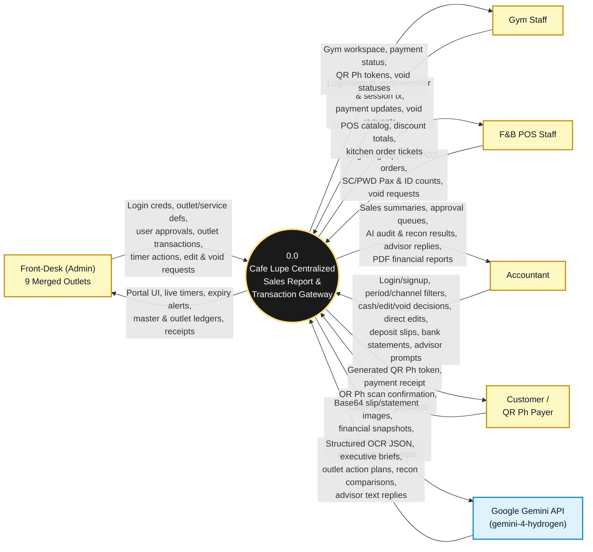
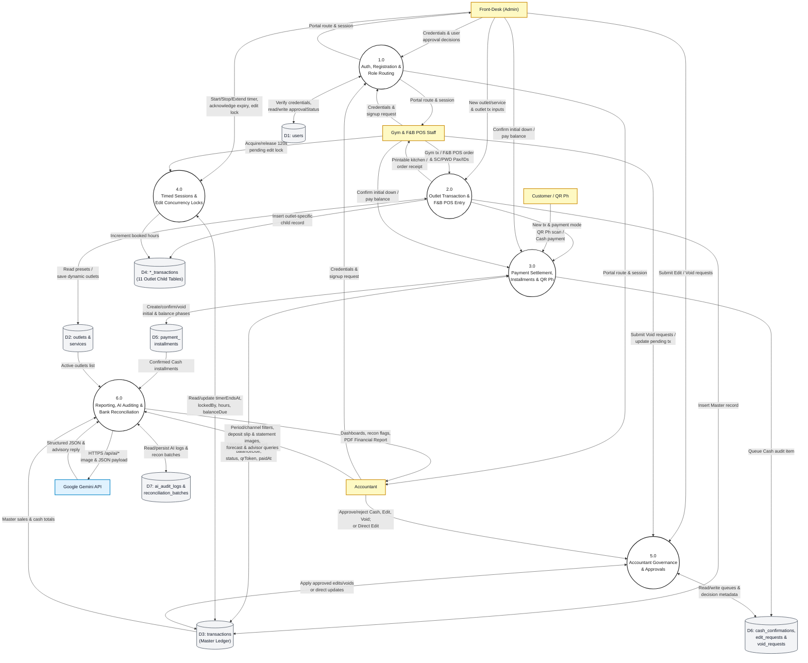

# Cafe Lupe Centralized Sales Report & Transaction Gateway — Data Flow Diagram (DFD)

This document defines the **Level 0 (Context)**, **Level 1 (System Overview)**, and **Level 2 (Sub-Process)** Data Flow Diagrams for the **Cafe Lupe Centralized Sales Report and Transaction Gateway System** (Revision 002), mapped directly to the implemented React client, `CafeLupeStore` relational engine (`src/db/store.ts`), and Express Gemini AI proxy (`server.ts`).

---

## Legend

- **Rectangle `[Entity]`**: External Entity (human actor or external system)
- **Rounded Pill / Circle `((Process))`**: System Process (`1.0` – `6.0`)
- **Cylinder `[(Data Store)]`**: Persistent Data Store (`D1` – `D7`, backed by `localStorage` under `cafelupe_v3_rev002_` / target MySQL schema)
- **Arrow `-->|data flow|`**: Directed movement of data between entities, processes, and stores

---

## 1. Level 0 — Context Diagram

Shows the system boundary and all data exchanged with external actors and third-party services.



---

## 2. Level 1 — Core System Data Flow Diagram

Decomposes the gateway into six primary processes and seven normalized data stores.



---

## 3. Level 2A — Transaction Creation, Split-Payment & QR Ph Settlement Flow

Details how processes `2.0` and `3.0` handle pricing, SC/PWD discounts, normalized child inserts, and Revision 002 two-step Down Payment vs. Full Payment settlements.

```mermaid
flowchart TD
    classDef entity fill:#FEF9C3,stroke:#CA8A04,stroke-width:2px,color:#111827
    classDef proc fill:#FFFFFF,stroke:#1A1A1A,stroke-width:2px,color:#1A1A1A
    classDef store fill:#F3F4F6,stroke:#4B5563,stroke-width:1.5px,color:#111827

    CLERK["Front-Desk / Gym /<br/>F&B POS Clerk"]:::entity
    PAYER["Customer / QR Ph App"]:::entity

    P2_1(("2.1<br/>Compute Gross Total<br/>& SC/PWD Discount")):::proc
    P2_2(("2.2<br/>Write Master &<br/>Child Records")):::proc
    P3_1(("3.1<br/>Full Payment<br/>Settlement")):::proc
    P3_2(("3.2<br/>Two-Step Down Payment<br/>& Balance Switcher")):::proc
    P3_3(("3.3<br/>QR Ph Prototype<br/>Validation")):::proc

    D2[("D2: services")]:::store
    D3[("D3: transactions")]:::store
    D4[("D4: *_transactions")]:::store
    D5[("D5: payment_installments")]:::store
    D6[("D6: cash_confirmations")]:::store

    CLERK -->|Outlet inputs / POS cart,<br/>SC/PWD flag, Pax & Valid IDs| P2_1
    D2 -->|Preset prices| P2_1
    P2_1 -->|Standard: (Price/1.12)*0.80<br/>F&B: ((Bill/1.12)/Pax*IDs)*0.20| P2_2

    P2_2 -->|Create TRX-YYYY-NNNN| D3
    P2_2 -->|Create outlet row via<br/>outletRefTable + outletRefId| D4
    P2_2 -->|Create 'initial' installment| D5

    P2_2 -->|arrangement = Full Payment| P3_1
    P2_2 -->|arrangement = Down Payment| P3_2

    P3_1 -->|Channel = Cash or Total = 0:<br/>status='paid', balanceDue=0| D3
    P3_1 -->|Cash > 0: queue 'pending_audit'| D6
    P3_1 -->|Channel = QRPh: generate qrToken| P3_3

    P3_2 -->|Starts pending (amountPaid=0)| D3
    CLERK -->|Confirm Initial Cash| P3_2
    P3_2 -->|Customer Cancels Initial:<br/>status='void' & inst='voided'| D3
    P3_2 -->|Initial Cash confirmed:<br/>tx stays 'pending' w/ balanceDue| D6
    P3_2 -->|Initial or Balance = QRPh| P3_3
    CLERK -->|Pay Balance (Cash / QRPh switch)| P3_2
    P3_2 -->|Record 'balance' installment<br/>& mark tx 'paid'| D5
    P3_2 -->|Cash balance audit item| D6

    PAYER -->|Simulate QR Ph Scan| P3_3
    P3_3 -->|Confirm pending installment| D5
    P3_3 -->|Initial down: deduct down & stay 'pending'<br/>Full/Balance: set status='paid', balanceDue=0| D3
```

---

## 4. Level 2B — Accountant AI Auditing, Bank Reconciliation & PDF Reporting Flow

Details how process `6.0` bridges the client-side `CafeLupeStore` with the server-side Express `/api/ai/*` Gemini proxy (`server.ts`) and `jsPDF` exporter (`src/utils/pdfReport.ts`).

```mermaid
flowchart LR
    classDef entity fill:#FEF9C3,stroke:#CA8A04,stroke-width:2px,color:#111827
    classDef extSys fill:#E0F2FE,stroke:#0284C7,stroke-width:2px,color:#0F172A
    classDef proc fill:#FFFFFF,stroke:#1A1A1A,stroke-width:2px,color:#1A1A1A
    classDef store fill:#F3F4F6,stroke:#4B5563,stroke-width:1.5px,color:#111827

    ACC["Accountant"]:::entity
    GEMINI["Google Gemini API<br/>(gemini-4-hydrogen)<br/>via GEMINI_API_KEY"]:::extSys

    D3[("D3: transactions")]:::store
    D5[("D5: payment_installments")]:::store
    D7[("D7: ai_audit_logs &<br/>reconciliation_batches")]:::store

    P6_1(("6.1<br/>Daily Cash Deposit<br/>Validation")):::proc
    P6_2(("6.2<br/>Financial Analysis &<br/>PDF Export")):::proc
    P6_3(("6.3<br/>Outlet Forecasting &<br/>AI Business Advisor")):::proc
    P6_4(("6.4<br/>Per-Outlet Bank<br/>Reconciliation")):::proc
    EXPRESS["Express Proxy<br/>server.ts (/api/ai/*)"]:::proc

    %% Store Inputs
    D5 -->|Confirmed Cash installments<br/>by targetDate| P6_1
    D3 -->|Master transactions,<br/>revenue, channels, outlets| P6_1
    D3 -->|Filtered period metrics<br/>& outlet/channel breakdown| P6_2
    D3 -->|Gross revenue, receivables,<br/>outlet metrics| P6_3
    D3 -->|Outlet transactions in<br/>startDate..endDate| P6_4

    %% Accountant Inputs & Outputs
    ACC -->|Target date + Base64<br/>deposit slip image| P6_1
    ACC -->|Period filter +<br/>Download PDF click| P6_2
    ACC -->|External context +<br/>Advisor questions| P6_3
    ACC -->|Outlet + date range +<br/>Base64 bank statement image| P6_4

    %% Express Proxy <-> Gemini
    P6_1 -->|POST /api/ai/deposit-validate| EXPRESS
    P6_2 -->|POST /api/ai/financial-summary| EXPRESS
    P6_3 -->|POST /api/ai/forecasting<br/>POST /api/ai/advisor| EXPRESS
    P6_4 -->|POST /api/ai/reconcile| EXPRESS

    EXPRESS <-->|@google/genai<br/>Multimodal OCR &<br/>JSON Schema / Chat| GEMINI

    EXPRESS -->|Extracted total, variance,<br/>matched/conflict| P6_1
    EXPRESS -->|Executive summary,<br/>findings, recommendations| P6_2
    EXPRESS -->|Outlet action plans &<br/>advisor replies| P6_3
    EXPRESS -->|Extracted entries &<br/>line-by-line comparisons| P6_4

    %% Persistence & Output
    P6_1 -->|Save AUD-* log| D7
    P6_2 -->|Save AUD-* log| D7
    P6_3 -->|Save AUD-* log| D7
    P6_4 -->|Save REC-* batch| D7

    P6_2 -->|jsPDF report file| ACC
    P6_1 -->|Discrepancy alert| ACC
    P6_3 -->|Action plans & chat| ACC
    P6_4 -->|Matched/conflict table| ACC
```

---

## 5. Data Flow & Code Mapping Reference

| Flow / Component | Origin -> Destination | Code Implementation |
| :--- | :--- | :--- |
| **Role Authentication & Routing** | `LoginView` -> `D1: users` -> `App.tsx` | `store.authenticate()`, `store.registerUser()`, `store.updateUserApproval()` (`src/db/store.ts`, `src/App.tsx`) |
| **Master + Child Transaction Write** | `OutletTransactionForm` / `PosTerminal` -> `D3: transactions` + `D4: *_transactions` | `store.createTransaction()` (`src/db/store.ts`) |
| **SC/PWD Discount Calculation** | Clerk/POS Input -> Pricing Engine -> `D3: transactions` | `calculateDiscountBreakdown()`, `calculateFnbScPwdDiscount()` (`src/db/store.ts`) |
| **Split Down Payment & Mode Switch** | `PaymentWorkflowModals` / `QrPhModal` -> `D5: payment_installments` + `D3` + `D6` | `store.confirmInitialDownPayment()`, `store.voidCancelledInitialPayment()`, `store.payBalance()`, `store.validateQrPayment()` |
| **Timers & 120s Pessimistic Edit Locks** | `OutletWorkspace` -> `D3: transactions` + `D4` | `store.acquireLock()`, `store.releaseLock()`, `store.extendTimedTransaction()`, `store.stopTimer()`, `store.acknowledgeTimer()` |
| **Governance Queues & Direct Edits** | `AdminDashboard` / `OutletWorkspace` -> `D6` -> `AccountantDashboard` -> `D3` | `store.createVoidRequest()`, `store.decideVoidRequest()`, `store.createEditRequest()`, `store.decideEditRequest()`, `store.approveCashConfirmation()`, `store.accountantDirectUpdate()` |
| **Server-Side AI Auditing & Recon** | `AccountantAiViews` -> `server.ts` -> Gemini API -> `D7` | `/api/ai/deposit-validate`, `/api/ai/financial-summary`, `/api/ai/forecasting`, `/api/ai/advisor`, `/api/ai/reconcile` (`server.ts`, `store.addAiAuditLog()`, `store.addReconciliationBatch()`) |
| **PDF Financial Report Export** | `FinancialAnalysisView` + `D3` + AI Summary -> `Accountant` | `downloadFinancialPdfReport()` (`src/utils/pdfReport.ts`) |
