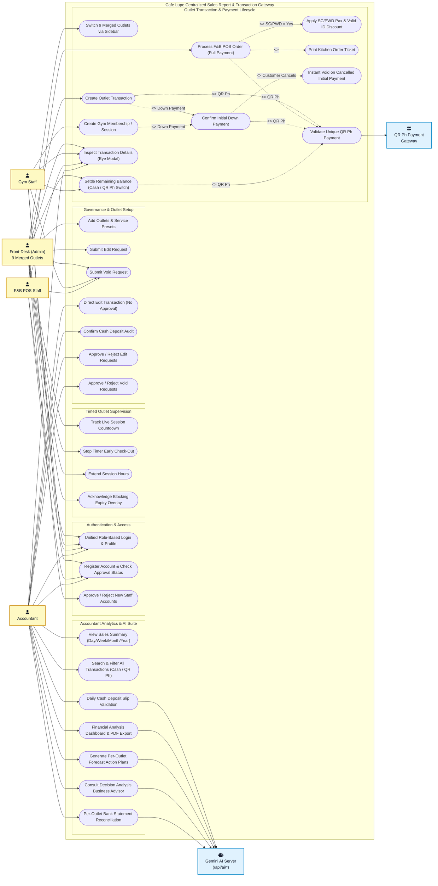

# Cafe Lupe Centralized Sales Report & Transaction Gateway — Use-Case Diagram (Revision 002)

This document maps all **actors**, **system capabilities**, and **UML `<<include>>` / `<<extend>>` relationships** implemented in Revision 002 of the **Cafe Lupe Transaction Gateway**.

---

## 1. Master System Use-Case Diagram

---

## 2. Role & Capability Matrix

| Actor | Primary Responsibilities | Outlet / Portal Scope |
| :--- | :--- | :--- |
| **Front-Desk (Admin)** | Staff account approvals, outlet/service management (`Add outlet`), operating all 9 merged outlets via the sidebar Outlet Selector, timed session controls (`Stop`, `Extend`, blocking expiry `Acknowledge`), submitting Edit & Void requests to Accountant | Pickleball, Hostel, Swimming Pool, KTV Rooms, Billiards, Table Tennis, Parking Lot, Events & Location Rentals |
| **Gym Staff** | Recording Annual/Monthly/Per-Session/Self-Train transactions, collecting Cash/QR Ph & Down Payments, inspecting transaction details (`Eye`), submitting Void requests | Gym & Combat Training |
| **F&B POS Staff** | Ordering across Food & Drinks catalog, applying `Pax + Valid SC/PWD IDs` discount formula, upfront Full Payment (`Cash` / `QR Ph`), printing kitchen receipts | Restaurant / F&B POS |
| **Accountant** | Reviewing Sales Summary & History (`Cash` / `QR Ph` filters + multi-attribute search), direct edits without approval, approving **Cash Confirmations / Edit Requests / Void Requests**, running the 5 Gemini AI modules & downloading PDF reports | All Outlets (Central Governance & AI Suite) |
